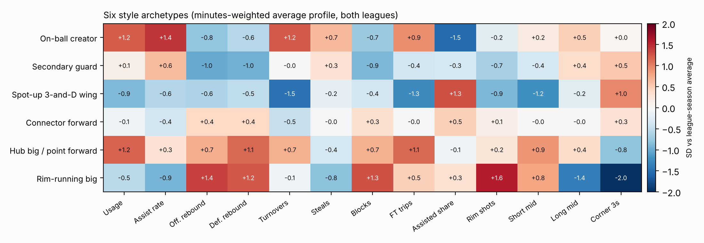

Six style archetypes are fitted jointly on both leagues, with each feature measured relative to its own
league and season. Sub-types split each archetype further (e.g. *Alpha scorer*, *Floor general* and
*Shot-making scorer* inside *On-ball creator*).



## How the mix has shifted

Share of all minutes played by each archetype, by season.

```{python}
import plotly.graph_objects as go
from plotly.subplots import make_subplots
from _viz import show, read, SERIES
s = read("archetype_share_by_season.csv")
order = s.groupby("archetype").minutes_share.mean().sort_values(ascending=False).index.tolist()
fig = make_subplots(rows=1, cols=2, subplot_titles=("NBA", "WNBA"), shared_yaxes=True, horizontal_spacing=0.06)
colors = dict(zip(order, ["#2a78d6", "#eb6834", "#1baf7a", "#eda100", "#e87ba4", "#008300"]))
for j, lg in enumerate(["NBA", "WNBA"], 1):
    for a in order:
        d = s[(s.league == lg) & (s.archetype == a)]
        fig.add_scatter(x=d.season, y=d.minutes_share, name=a, legendgroup=a, showlegend=(j == 1),
                        mode="lines", line=dict(color=colors[a], width=2),
                        hovertemplate=a + ": %{y:.0%}<extra></extra>", row=1, col=j)
fig.update_yaxes(tickformat=".0%", rangemode="tozero")
fig.update_layout(height=430, legend=dict(y=-0.15, orientation="h"))
show(fig)
```

## How trustworthy are the labels?

```{python}
from IPython.display import Markdown
v = read("step3_validation_summary.csv")
v["estimate"] = v.estimate.round(2); v["95% range"] = [("" if lo != lo else f"{lo:.2f} to {hi:.2f}") for lo, hi in zip(v.lo95, v.hi95)]
Markdown(v[["check", "estimate", "95% range", "how_to_read"]].to_markdown(index=False))
```
